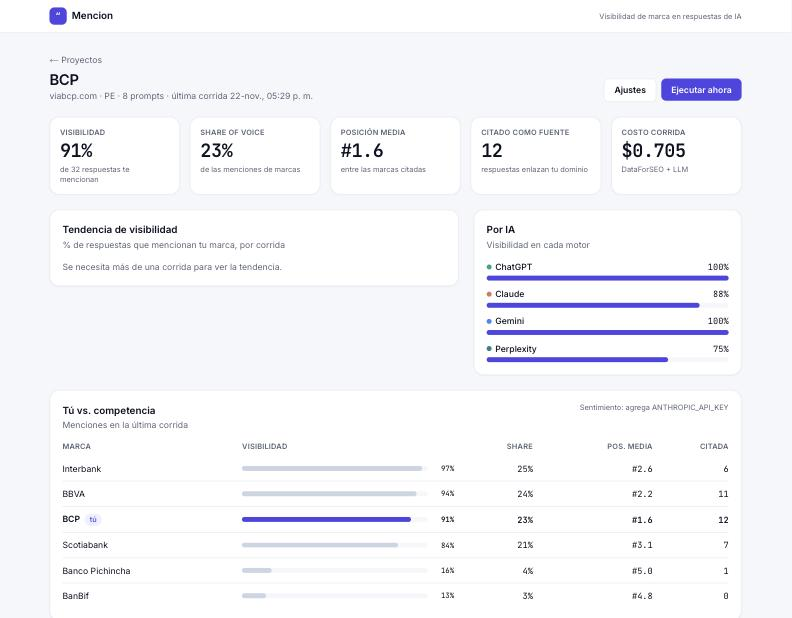

# Mencion

**¿Las IAs recomiendan tu marca?** Mencion le hace a ChatGPT, Claude, Gemini y Perplexity las mismas preguntas que
tus clientes y mide en cuántas respuestas apareces, en qué posición, con qué tono y qué fuentes citan, frente a tu
competencia.

🌐 [mencion.org](https://mencion.org)



## Qué mide

| Métrica | Cómo se calcula |
|---|---|
| Visibilidad | % de respuestas (prompts × IAs) que mencionan tu marca |
| Share of voice | tus menciones / menciones de todas las marcas seguidas |
| Posición media | orden en que aparece tu marca entre las marcas nombradas |
| Citado como fuente | respuestas que enlazan tu dominio |
| Sentimiento | Claude clasifica cada mención en positiva / neutral / negativa (opcional) |
| Fuentes top | dominios que más enlazan las IAs, para saber dónde conseguir presencia |

## Arquitectura

```
prompts ──► DataForSEO AI Optimization API ──► detección de marcas ──► (Claude: sentimiento) ──► SQLite ──► dashboard
             ├─ ChatGPT: LLM Scraper (respuesta como la ve un usuario, con fuentes)
             └─ Claude / Gemini / Perplexity: LLM Responses con búsqueda web
```

- `src/lib/dataforseo.ts`: cliente de la API (Basic auth, un task por llamada Live).
- `src/lib/analysis.ts`: detección determinista de menciones (nombre, alias, dominio; sin tildes) más sentimiento con Claude usando salida estructurada.
- `src/lib/runner.ts`: ejecuta prompts × motores con concurrencia limitada y guarda costo y errores por consulta.
- `src/lib/stats.ts`: KPIs, share of voice, tendencia y dominios citados.
- Stack: Next.js 16, Prisma 7 + SQLite (se cambia a Postgres en producción) y Tailwind 4.

## Puesta en marcha

```bash
npm install
cp .env.example .env        # agrega tus credenciales
npx prisma migrate dev
npm run db:seed             # proyecto demo con datos ficticios (opcional)
npm run dev                 # http://localhost:3030
```

Variables (`.env`):

- `DATAFORSEO_LOGIN` / `DATAFORSEO_PASSWORD`: credenciales de API de https://app.dataforseo.com/api-access
- `ANTHROPIC_API_KEY`: opcional, activa el análisis de sentimiento
- `MODEL_CLAUDE`, `MODEL_GEMINI`, `MODEL_PERPLEXITY`: modelos por motor (`npm run models` lista los disponibles)
- `SHOW_DEMO_DATA=true`: muestra el proyecto demo, marcado como tal en la interfaz

## Despliegue

Guía paso a paso (Railway, dominio y cron): [docs/DEPLOY.md](docs/DEPLOY.md). En producción define `APP_PASSWORD`.

## Corrida diaria

```bash
npm run track   # ejecuta todos los proyectos; prográmalo con cron
```

## Costos aproximados (tarifas de DataForSEO, nov 2026)

- ChatGPT (LLM Scraper Live): unos $0.004 por prompt
- Claude, Gemini y Perplexity (LLM Responses Live): $0.0006 por tarea más lo que cobra el modelo
- 25 prompts × 4 IAs al día ≈ 3.000 consultas al mes; el costo real de cada corrida aparece en el dashboard

## Honestidad de datos

El proyecto demo usa marcas y dominios ficticios (`.example`) y se identifica en la interfaz. Los proyectos reales
solo muestran lo que devolvió la API, y cada error queda registrado por consulta.
